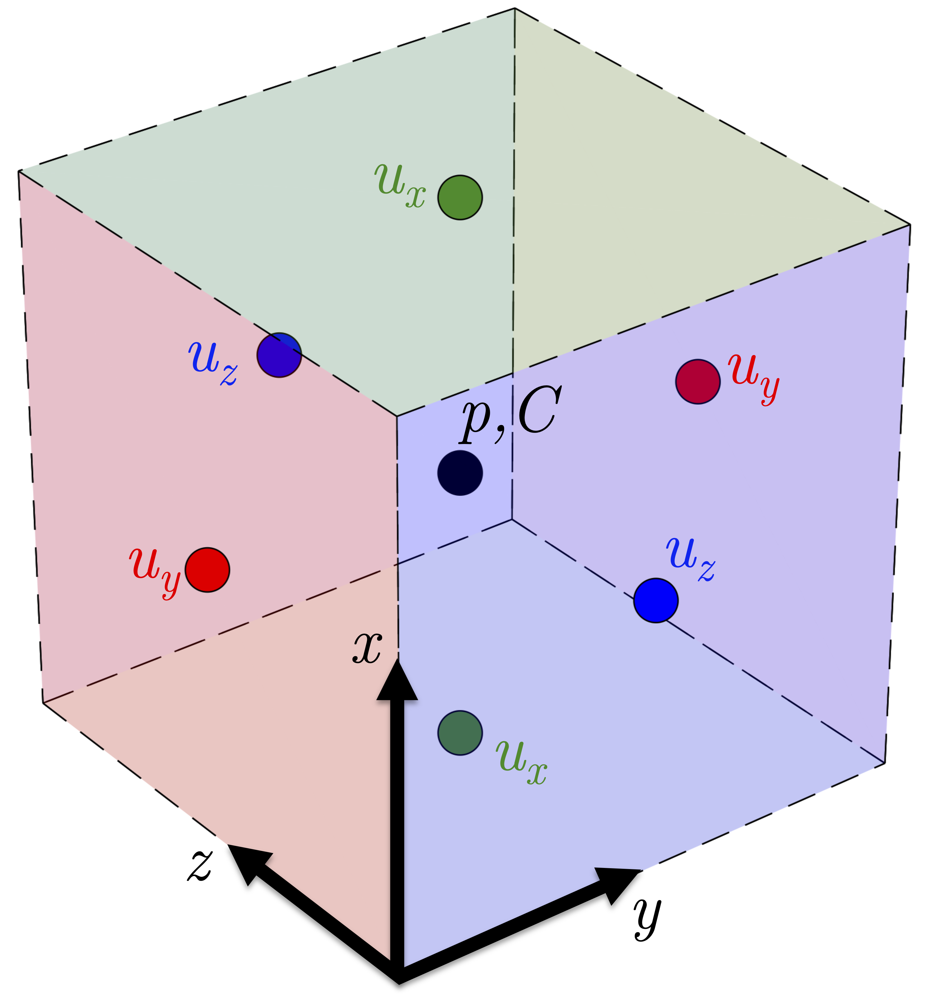

# Numerics

A full description of the algorithm is provided by De Paoli, M., Yerragolam, G. S., Lohse, D., & Verzicco, R. AFiD-Darcy: A finite difference solver for numerical simulations of convective porous media flows.

## Governing equations

The code is designed to solve incompressible Rayleigh-Darcy equations in the non-dimensional form. The governing equations are the transport equation for the scalar $C$

$$\frac{\partial C}{\partial t}+\nabla \cdot \left( {\bf u} C \right)=\nabla \cdot \left( D \nabla C\right),$$

the equation describing the velocity field $\bf{u}$

$${\bf u}=-\left( \nabla p + C {\bf i}\right),$$

and the incompressibility condition

$$\nabla\cdot{\bf u}=0,$$

with $p$ being the kinematic pressure and $D$ the diffusion coefficient. 

## Boundary conditions

## Initial conditions

### Scalar field 

### Velocity field

## Solver

### Spatial discretization
Second order central difference scheme is used on a staggered grid for spatial discretization. 

The velocity components are at the face centres, while the scalar $C$ and the pressure are at the cell centre.

During the initialization of the simulation, the Cartesian grid coordinates are generated from the [grid input parameters](inputs.md#grid-specification-200-299). Some useful arrays are stored by the subroutine [`CreateGrid`](../src/CreateGrid.F90). These are listed below.

#### Index arrays

#### Grid coordinate arrays

#### Discrete operator arrays

Any derivative operator in its discrete form can be represented as a linear algebraic sum of values at all grid points in the stencil.

##### First order derivatives
At any given grid index `k`, `j`, and `i`, the operation $\partial^2_x (C)$ can be represented in the discrete form as 

##### Second order derivatives

At any given grid index `k`, `j`, and `i`, the operation $\partial^2_x (C)$ evaluated at cell centre (`xm` grid) can be represented in the discrete form as

$$A(C_{k,j,i}) = f_m C_{k-1,j,i} + f_c C_{k,j,i} + f_p C_{k+1,j,i},$$

or in the code as \
`am3sk(k)*temp(k-1,j,i) + ac3sk(k)*temp(k,j,i) + ap3sk(k)*temp(k+1,j,i)` \
The arrays `am3sk(k)`, `ac3sk(k)`, and `ap3sk(k)` 

#### Interpolation arrays

### Time stepping scheme

#### General algorithm
The general algorithm is outlined in this subsection. The specific cases are listed in the subsequent subsections for [semi implicit](#semi-implicit-formulation) and [fully implicit](#fully-implicit-formulation) formulations. The subroutine [`TimeMarcher`](../src/TimeMarcher.F90) handles the total update of all flow-fields within a single sub step.

##### Step 1 - Explicit terms
Explicit terms are treated either using a second order Adams–Bashforth or a third order Runge–Kutta scheme, and implicit terms are treated using a second order Crank–Nicolson scheme (see [Rai and Moin (1991) J. Comp. Phys.](https://www.sciencedirect.com/science/article/pii/002199919190264L)). The advective terms are always computed explicitly in the subroutine [`ExplicitTermsTemp`](../src/ExplicitTermsTemp.F90). For details regarding the computation of advective terms, refer to [computation of advection terms](#advection-terms). 

##### Step 2 - Implicit solve
We seek to solve the equation

$$\frac{C^{l+1}-C^l}{\Delta t} = \gamma_l H^l + \rho_l H^{l-1} + \alpha_l (A)\frac{C_i^{l+1} + C_i^l}{2},$$

with the superscript $l$ being the substep, $H$ the explicit terms and $A$ being the operator that provides the implicit terms when applied to $C$.

The coefficients $\gamma_l$, $\rho_l$, and $\alpha_l$ for the AB2 or RK3 time stepping schemes are initialized in the subroutine [`InitTimeMarchScheme`](../src/InitTimeMarchScheme.F90), and are tabulated below.

#### 2nd order Adams–Bashforth time stepping scheme 
| $l$ | $\gamma_l$ | $\rho_l$ | $\alpha_l = \gamma_l + \rho_l$ |
|:---:|:----------:|:--------:|:------------------------------:|
|1    | 3/2        | -1/2     | 1                              |

#### 3rd order Runge–Kutta time stepping scheme
| $l$ | $\gamma_l$ | $\rho_l$ | $\alpha_l = \gamma_l + \rho_l$ |
|:---:|:----------:|:--------:|:------------------------------:|
|1    | 8/15       | 0        | 8/15                           |
|2    | 5/12       | -17/60   | 2/15                           |
|3    | 3/4        | -5/12    | 1/3                            |

Instead of solving for $C^{l+1}$, AFiD solves for $\Delta C = C^{l+1} - C^l$ in the following way

$$[1-\dfrac{\alpha_l}{2}\Delta t (A)](\Delta C) = \Delta t \left[ \gamma_l H^l + \rho_l H^{l-1} + \alpha_l (A)  C^l \right].$$

Subsequently, $C^{l+1} = C^l + \Delta C$ can be used to update the array `temp` which stores $C^l$. Typically, this is done by the subroutine [`ImplicitAndUpdateTemp`](../src/ImplicitAndUpdateTemp.F90) which in turn calls subroutine [`SolveImpEqnUpdate_Temp`](../src/SolveImpEqnUpdate_Temp.F90) in order to solve the system of linear equations that arise from the discretized equations. The tridiagonal matrix resulting from the system of linear equations is factorized using `dgttrf` routine and solved using `dgttrs` routine. Both routines are from the `LAPACK/Intel MKL` libraries. In case of the iterative solver turned on, subroutine [`ImplicitAndIterateTemp`](../src/ImplicitAndIterateTemp.F90) is called which in turn calls subroutine [`SolveImpEqnIterate_Temp`](../src/SolveImpEqnIterate_Temp.F90) in order to iteratively solve the system of linear equations that arise from the discretized equations. Further details are given in [semi implicit](#semi-implicit-formulation) and [fully implicit](#fully-implicit-formulation) formulations.

Once the scalar field is updated, a [halo update](parallelization.md#halo-cell-update) of `temp` array takes place.

##### Step 3 - Compute velocity field
Once the scalar $C^l$ is updated to $C^{l+1}$, the intermediate velocity field is computed by the subroutine [`SetVelocityField`](.../src/SetVelocityField.F90) using 

$$\begin{align}
u^* = -C^{l+1} g_x - \partial_x p^l, \\
v^* = -C^{l+1} g_y - \partial_y p^l, \\
w^* = -C^{l+1} g_z - \partial_z p^l,
\end{align}$$

with $u^*$ stored in `vx`, $v^*$ stored in `vy`, and $w^*$ stored in `vz`. As a boundary condition, the wall-normal velocity at the top and bottom walls is always set to zero. Once the velocity field is updated, a [halo update](parallelization.md#halo-cell-update) of `vy` and `vz` arrays takes place. No [halo update](parallelization.md#halo-cell-update) of `vx` array is required as no horizontal gradients of vertical velocity are needed to obtain the divergence in the following computation.

##### Step 4 - Pressure correction for divergence free velocity
Next, the divergence of the intermediate velocity field $\partial_x u^* + \partial_y v^* + \partial_z w^*$ is computed by [`CalcLocalDivergence`](../src/CalcLocalDivergence.F90) and stored in the array `dph`. This is passed to the pressure solver subroutine [`SolvePressureCorrection`](../src/SolvePressureCorrection.F90) where the following equation is solved

$$(\partial^2_x + \partial^2_y + \partial^2_z) \phi = - (\partial_x u^* + \partial_y v^* + \partial_z w^*).$$

The array `dph` is overwritten with the pressure correction $\phi$. For more details on the implementation, refer to [details of the pressure solver](#pressure-solver). The pressure at the next sub step is obtained by

$$p^{l+1} = p^l + \phi.$$

In order to compute the gradient on distributed memory, data from `dph` array is copied onto `dphhalo` array which contains halo cells and therefore, a [halo update](parallelization.md#halo-cell-update) can be performed on it. Both these operations are performed by subroutine [`CorrectPressure`](../src/CorrectPressure.F90). The gradient of the pressure correction is applied to the intermediate velocity field to obtain the divergence free velocity field at the next sub step in subroutine [`CorrectVelocity`](../src/CorrectVelocity.F90) as

$$\begin{align}
u^{l+1} = u^* - \partial_x \phi, \\
v^{l+1} = v^* - \partial_y \phi, \\
w^{l+1} = w^* - \partial_z \phi.
\end{align}$$

After this, a [halo update](parallelization.md#halo-cell-update) on both `dph` and `pr` arrays is performed.

In the subsequent subsections, some notes are highlighted for how 

#### Semi implicit formulation

For the semi implicit formulation, only the dissipation terms in the vertical ($x$) direction are treated implicitly. Rest of the terms are treated explicitly

- In [step 1](#step-1---explicit-terms), [advection terms](#advection-terms) are computed. Additionally, dissipation terms in the horizontal directions are computed explicitly. All the explicit terms are stored in `hro`.

- In [step 2](#step-2---implicit-solve), the operator $A$ is given by $A = \frac{1}{Ra} \partial^2_x$.  (see details regarding [discrete operators](#discrete-operator-arrays)). 

- Steps [3](#step-3---compute-velocity-field) and [4](#step-4---pressure-correction-for-divergence-free-velocity) proceed as per the general algorithm

#### Fully implicit formulation

For the fully implicit formulation, the dissipation terms in all directions are treated implicitly

-   In [step 1](#step-1---explicit-terms), [advection terms](#advection-terms) are computed and stored in `hro`. 

-   In [step 2](#step-2---implicit-solve), $A = \frac{1}{Ra} \left(\partial^2_x + \partial^2_y + \partial^2_z \right)$ means that the following equation must be solved.

    $$[1 - \frac{\Delta t}{2Ra} \left(\partial^2_x + \partial^2_y + \partial^2_z \right)](\Delta C) = \Delta t \left[ \gamma_l H^l + \rho_l H^{l-1} + \alpha_l \frac{1}{Ra} \left(\partial^2_x C^l + \partial^2_y C^l + \partial^2_z C^l \right) \right].$$

### Advection terms

### Dissipation terms

### Pressure solver

